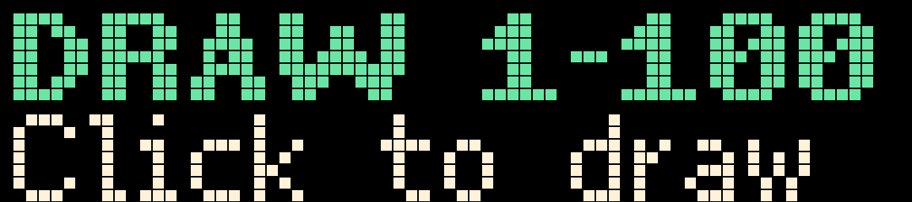

# Tumbler Draw

Draw a number or a name. The digits roll like a combination lock, settle from left to right, then reveal the selection in your chosen color.

## Setup

In **Setup**, leave **Local companion URL** blank for an offline draw. Enter an integer from 1 to 9,999,999 in **Highest number**. For names, put up to 240 characters such as `Robin|Avery|Kim` in **Names separated by |**. A list overrides the numeric range. Set **Result color in hex** to a six-digit color such as `#63DF91`. Restart the app after changing settings. For longer lists, the example companion reads one name per line (up to 150 entries).

For the optional external pool, run the companion from the repository root.

```sh
cp companion/example.json config.json
# Edit config.json for your source before starting the server.
python3 companion/serve.py --config config.json
```

In the emulator, run `~/.busy-emulator/bin/busy-emulator allow-local 8770` and approve that port. Open **Apps → Tumbler Draw → Setup**, set **Local companion URL** to `http://127.0.0.1:8770/reading`, save, then reopen the app. For a physical bar, start the companion with `--host YOUR_LAN_IP` and replace `127.0.0.1` with that address. Bind only to your trusted network. Open `/reading` on the host to inspect the current reading. Keep credentials in the host environment.

## Draw a numbered entry

Set Highest number to 100 and click once. Watch the digits settle. The draw includes 1 and 100. The result stays until you click again.



## Use a live count or a list

For YouTube, enable YouTube Data API v3, export `YOUTUBE_KEY`, and use `{"mode":"youtube","video":"VIDEO_ID"}`. For an IMAP account that supports password or app-password login, set `IMAP_PASSWORD` and use `{"mode":"imap","host":"imap.example.com","username":"you@example.com","mailbox":"INBOX"}`. YouTube uses the video’s reported comment count. IMAP counts messages in that folder. Both produce an entry number. To reveal a particular person, use a list of names. With a companion URL set, Start reloads the pool and click makes a draw.


## Run in the emulator

Install BUSY Bar Emulator and open it. From this repository run the following command, then press **Back** when you finish.

```sh
~/.busy-emulator/bin/busy-emulator dev --once
```

The recordings show device controls on emulator firmware. Each display pixel is enlarged to a 9 × 9 square.

[YouTube video statistics](https://developers.google.com/youtube/v3/docs/videos#statistics.commentCount).

[Rear display](screenshots/back-1.png) · [MIT license](LICENSE)
